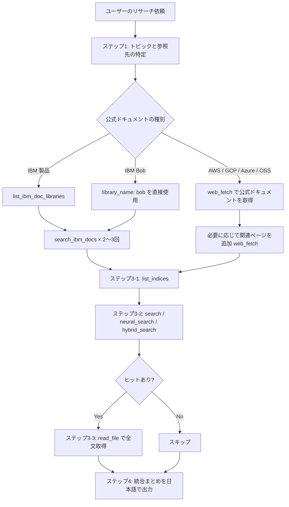

# opensearch-readonly MCP ツール 活用ガイド

> このドキュメントは `opensearch-readonly` MCP サーバーの使い方と、RAG（検索拡張生成）ユースケースにおける実践的な活用フローをまとめたものです。

---

## 目次

1. [ツールの基本説明と機能一覧](#1-ツールの基本説明と機能一覧)
2. [RAG ユースケースにおける活用シーン](#2-rag-ユースケースにおける活用シーン)
3. [スキルを使う vs. 直接使う — 使い分け基準](#3-スキルを使う-vs-直接使う--使い分け基準)
4. [スキルを使う場合の段階的な手順と実装フロー](#4-スキルを使う場合の段階的な手順と実装フロー)
5. [各手順の具体例とベストプラクティス](#5-各手順の具体例とベストプラクティス)
6. [実装時の注意点と最適化ヒント](#6-実装時の注意点と最適化ヒント)

---

## 1. ツールの基本説明と機能一覧

### 概要

`opensearch-readonly` は、ローカル OpenSearch クラスタに対して **読み取り専用** でアクセスする MCP（Model Context Protocol）サーバーです。
TypeScript / stdio トランスポートで実装されており、Bob の MCP 設定 (`.bob/mcp.json`) に `opensearch-readonly` として登録されています。

```
接続先: OPENSEARCH_URL（既定: http://localhost:9200）
認証:   OPENSEARCH_USERNAME / OPENSEARCH_PASSWORD（オプション）
```

**読み取り専用の保証:** `_search` / `_count` / `_mget` / `_msearch` / `_analyze` / `_validate/query` / `_explain` の POST のみ許可。それ以外の書き込み操作はサーバー側でブロックされます。

---

### ツール一覧

| ツール名 | 用途 | 主なパラメータ |
|---|---|---|
| `cluster_health` | クラスタ状態・バージョン確認 | なし |
| `list_indices` | インデックス一覧取得 | `pattern`, `include_system` |
| `get_mapping` | フィールド定義・アナライザー確認 | `index` |
| `search` | BM25 全文検索（Query DSL） | `index`, `query`, `size`, `source`, `highlight_fields` |
| `count` | 条件に一致するドキュメント数 | `index`, `query` |
| `aggregate` | カテゴリ別件数などの集計 | `index`, `aggs`, `query` |
| `get_document` | ID 指定で 1 件取得 | `index`, `id` |
| `neural_search` | ベクトル類似度検索（kNN） | `index`, `query_text`, `model_id`, `vector_field` |
| `hybrid_search` | BM25 + ベクトルのハイブリッド検索 | `index`, `keyword_query`, `keyword_field`, `neural_query_text`, `model_id`, `vector_field` |
| `analyze_text` | テキストのトークン分割結果確認 | `index`, `analyzer`, `text` |

---

### 本プロジェクトのインデックス構造

| インデックス | 用途 | 主な本文フィールド |
|---|---|---|
| `ja-documents` | BM25 全文検索用 | `attachment.content`（text / ja_analyzer） |
| `ja-documents-knn` | ベクトル検索対応版 | `chunks_embedding`（nested、チャンクごとの knn_vector、512 次元） |

> **注意:** `filename` / `attachment.content_type` / `attachment.language` は `keyword` 型のため、`match` クエリは効かず `term` クエリを使う。

---

## 2. RAG ユースケースにおける活用シーン

### シーン 1: 社内 PDF / Office 資料の調べ物

ユーザーが「〇〇についての社内資料を探して」と依頼した際に、OpenSearch に登録済みの PDF / PPTX / DOCX などのドキュメントをキーワード検索し、関連箇所を提示する。

```
① search（BM25）→ ② get_document（全文取得）→ ③ 回答生成
```

### シーン 2: 外部公式ドキュメント × 社内資料のクロスリサーチ

`opensearch-research` スキルを使い、外部の公式ドキュメントとローカル OpenSearch インデックスの両方を検索して統合まとめを作成する。技術調査・提案書作成・比較検討に適している。

| 参照先 | 使用ツール | 備考 |
|---|---|---|
| IBM 製品（Db2、watsonx、Bob など） | `list_ibm_doc_libraries` → `search_ibm_docs` | 専用 API で高精度検索 |
| AWS（Lambda、S3、RDS など） | `web_fetch` で公式ドキュメントを直接取得 | `docs.aws.amazon.com` を起点に辿る |
| Google Cloud / Azure / OSS など | `web_fetch` で公式サイトを直接取得 | 各サービスのドキュメントトップから辿る |

```
【IBM の場合】
① list_ibm_doc_libraries → ② search_ibm_docs → ③ search（BM25）→ ④ 統合まとめ

【AWS / その他の場合】
① web_fetch（公式ドキュメント取得）→ ② search（BM25）→ ③ 統合まとめ
```

### シーン 3: 意味的に近い文書の発見（Neural Search）

キーワードではなく概念・文脈で文書を探したいとき。たとえば「コスト削減の事例」と入力すると、その言葉を使っていない文書でも意味的に近いものがヒットする。

```
① neural_search（kNN） → ② 関連文書の要約提示
```

前提: `ja-documents-knn` インデックスと ML Commons モデル（Granite Embedding 107M Multilingual）のデプロイが必要。Granite はプレフィックス不要なので、`query_text` には検索したい文をそのまま渡す。

### シーン 4: 高精度ハイブリッド検索（キーワード + 意味）

BM25 とベクトル検索を組み合わせることで、キーワード一致と意味的な類似度を同時に考慮する。日本語の専門文書で特に有効。

```
① hybrid_search（BM25 weight=0.4, neural weight=0.6）→ ② ランク統合結果を提示
```

### シーン 5: 検索デバッグ（ヒットしない原因の調査）

日本語テキストが期待通りにヒットしない場合、`analyze_text` でトークン分割を確認し、クエリのキーワードがどう分解されているかを調べる。

```
① analyze_text（ja_analyzer, "〇〇について"）→ ② トークン確認 → ③ クエリ修正
```

---

## 3. スキルを使う vs. 直接使う — 使い分け基準

### スキル（`opensearch-research`）を使うべきケース

以下の **すべて** に当てはまるとき:

- ユーザーが特定の **トピックについてのリサーチを依頼** している
- **外部の公式ドキュメント（IBM / AWS / その他）とローカル資料の両方** を参照する必要がある
- 結果を **統合した日本語まとめ** として出力したい

> 例（IBM）: 「OpenSearch のハイブリッド検索について、社内資料と IBM ドキュメントを調べてまとめて」
> 例（AWS）: 「Lambda のコールドスタート対策を AWS 公式と社内資料の両方から調べてまとめて」

### opensearch-readonly ツールを **直接** 使うべきケース

以下のどれかに当てはまるとき:

| 状況 | 直接使うべき理由 |
|---|---|
| ローカルドキュメントだけを検索したい | 外部ドキュメントの検索は不要 |
| 特定フィールドの値を集計・カウントしたい | `aggregate` / `count` ツールを直接使う |
| 検索クエリの動作検証・デバッグ | `analyze_text` / `get_mapping` を単独で使う |
| クラスタ状態の確認 | `cluster_health` / `list_indices` を直接確認 |
| 特定 ID のドキュメントを 1 件取得 | `get_document` を直接呼ぶ |
| ベクトル検索のみを実行したい | `neural_search` / `hybrid_search` を直接使う |

---

## 4. スキルを使う場合の段階的な手順と実装フロー

`opensearch-research` スキルを有効にした場合のフローを示します。



### ステップ 1 — トピックの確認

ユーザーのメッセージからリサーチ対象を特定する。不明な場合は `ask_followup_question` で確認する。

### ステップ 2 — 公式ドキュメントを検索

参照先に応じて使うツールを切り替える。

**IBM 製品・サービス（Db2、watsonx、IBM i、Bob など）:**
1. `list_ibm_doc_libraries` でライブラリ一覧を取得
2. 最も関連性の高いライブラリ名を選択（Bob 関連は `bob` を直接使用）
3. `search_ibm_docs` を 2〜3 回、視点を変えて実行（概要・機能詳細・前提条件など）

**AWS（EC2、Lambda、S3、RDS など）:**
1. `web_fetch` で `https://docs.aws.amazon.com/search/doc-search.html?searchPath=documentation&searchQuery=<キーワード>` を取得
2. 検索結果から関連ページの URL を特定し、さらに `web_fetch` で本文を取得
3. 英語ページを取得した場合は日本語に翻訳してまとめに含める

**その他（Google Cloud、Azure、Kubernetes、OpenSearch など）:**
1. 各サービスのドキュメントトップを `web_fetch` で取得
   - Google Cloud: `https://cloud.google.com/docs`
   - Azure: `https://learn.microsoft.com/ja-jp/azure/`
   - Kubernetes: `https://kubernetes.io/ja/docs/home/`
   - OpenSearch: `https://opensearch.org/docs/latest/`
2. 目的のページを辿って `web_fetch` で本文を取得

### ステップ 3 — OpenSearch インデックスを検索

1. `list_indices` でインデックス一覧を確認
2. `search`（BM25）で `ja-documents` を検索
3. ヒットしたドキュメントがあれば `read_file` で全文取得

> **なぜ read_file が必要か:** MCP ツールは本文を **2000 文字** で自動切り詰めるため、重要なドキュメントは `read_file` で全文を取得する必要がある。

### ステップ 4 — 結果の統合とまとめ作成

以下の構成で日本語のまとめを作成する:

1. **概要** — トピックの全体像を 2〜3 文で説明
2. **公式ドキュメントより** — ライブラリ名を明記して得られた情報をまとめる
3. **社内ドキュメント（OpenSearch）より** — ファイル名・出典を明記
4. **補足・差分** — 両ソースで内容が異なる場合や片方にしかない情報を明示

---

## 5. 各手順の具体例とベストプラクティス

### BM25 検索（`search`）の例

```json
// 日本語全文検索 — attachment.content に対して match クエリ
{
  "index": "ja-documents",
  "query": { "match": { "attachment.content": "コスト削減 クラウド移行" } },
  "size": 5,
  "source": ["filename", "attachment.content_type"],
  "highlight_fields": ["attachment.content"]
}
```

**ポイント:**
- `size` は 3〜5 件から始め、必要に応じて増やす
- `highlight_fields` を指定すると、ヒット箇所の前後 150 文字が `highlight` フィールドに返る
- `source` でフィールドを絞ることでレスポンスサイズを削減できる

---

### Neural Search の例

```json
// ベクトル類似度検索 — knn_vector フィールドに対して意味検索
{
  "index": "ja-documents-knn",
  "query_text": "コスト削減と効率化の事例",
  "model_id": "<デプロイ済み MODEL_ID>",
  "vector_field": "chunks_embedding.knn",
  "nested_path": "chunks_embedding",
  "k": 5,
  "source": ["filename", "attachment.content_type"]
}
```

**ポイント:**
- `query_text` は日本語・英語どちらでも可（多言語モデルを使用）
- `model_id` は `setup_vector_search.sh` 実行時に表示される値を使用
- `filter` を追加することでベクトル検索に絞り込み条件を重ねられる

---

### Hybrid Search の例

```json
// BM25 (40%) + ベクトル (60%) のハイブリッド検索
{
  "index": "ja-documents-knn",
  "keyword_query": "クラウド 移行コスト",
  "keyword_field": "attachment.content",
  "neural_query_text": "cloud migration cost optimization",
  "model_id": "<デプロイ済み MODEL_ID>",
  "vector_field": "chunks_embedding.knn",
  "nested_path": "chunks_embedding",
  "keyword_weight": 0.4,
  "neural_weight": 0.6,
  "size": 5
}
```

**ポイント:**
- `keyword_query` は日本語、`neural_query_text` は英語または日本語のどちらでも可
- 重み（`keyword_weight` + `neural_weight` = 1.0）はユースケースに応じて調整
- 専門用語が多い文書では `keyword_weight` を高めにすると精度が上がることが多い

---

### aggregate（集計）の例

```json
// content_type 別のドキュメント数を集計
{
  "index": "ja-documents",
  "aggs": {
    "by_type": {
      "terms": { "field": "attachment.content_type" }
    }
  }
}
```

---

### analyze_text（トークン分割確認）の例

```json
// 「機械学習」がどのように分割されるか確認
{
  "index": "ja-documents",
  "analyzer": "ja_analyzer",
  "text": "機械学習を活用したコスト最適化"
}
// 返り値例: ["機械", "学習", "活用", "コスト", "最適", "化"]
```

検索でヒットしない場合はこのツールでトークンを確認し、クエリのキーワードが分割後のトークンと一致するか確認する。

---

## 6. 実装時の注意点と最適化ヒント

### ⚠️ 2000 文字制限に注意

MCP ツールが返す本文はすべて **2000 文字** で自動切り詰められます。PDF 資料や長文ドキュメントの全内容が必要な場合は、必ず `read_file` でワークスペース内のファイルを直接読み取ってください。

```
ドキュメントパス: ingest/documents/<filename>
```

---

### ⚠️ keyword 型フィールドには term クエリを使う

| フィールド | 型 | 使うクエリ |
|---|---|---|
| `attachment.content` | text | `match` |
| `filename` | keyword | `term` |
| `attachment.content_type` | keyword | `term` |
| `attachment.language` | keyword | `term` |

```json
// NG: keyword フィールドに match は効かない
{ "match": { "filename": "report.pdf" } }

// OK: keyword フィールドは term を使う
{ "term": { "filename": "report.pdf" } }
```

---

### ⚠️ cluster が yellow でも正常

単一ノード構成のため、レプリカを置くノードがなく `yellow` ステータスになります。これは正常動作です。

---

### Neural Search / Hybrid Search の前提条件

- `ja-documents-knn` インデックスが作成されている（`ingest_documents_knn.sh` を実行済み）
- ML Commons モデルがデプロイされている（`setup_vector_search.sh` を実行済み）
- `MODEL_ID` が確認できている（`setup_vector_search.sh` 完了時に表示される）

---

### パフォーマンス最適化のヒント

| 状況 | 推奨アクション |
|---|---|
| 初回検索でどんな文書があるか確認 | `list_indices` → `count` でドキュメント数を把握 |
| クエリが意図通りか確認したい | `analyze_text` でトークンを確認してからクエリ設計 |
| 結果が多すぎて読めない | `source` でフィールドを絞り、`size` を 3〜5 件にする |
| キーワード検索でヒットしない | `hybrid_search` or `neural_search` で意味検索に切り替える |
| 意味検索でヒットしない | `keyword_weight` を上げて BM25 比重を増やす |
| フィールド定義を忘れた | `get_mapping` で確認してからクエリを組む |

---

### エラー対応チートシート

| エラー / 症状 | 原因と対処 |
|---|---|
| `keyword` フィールドで検索ヒットなし | `match` → `term` に変更 |
| BM25 で日本語がヒットしない | `analyze_text` でトークン確認 → クエリキーワードを分割後トークンに合わせる |
| Neural Search でモデルエラー | `cluster_health` 確認 → `setup_vector_search.sh` 再実行 |
| 本文が途中で切れている | `read_file` で `ingest/documents/<filename>` を直接読む |
| `hybrid_search` でスコアがおかしい | `keyword_weight + neural_weight = 1.0` になっているか確認 |

---

*最終更新: 2026-11-25*
